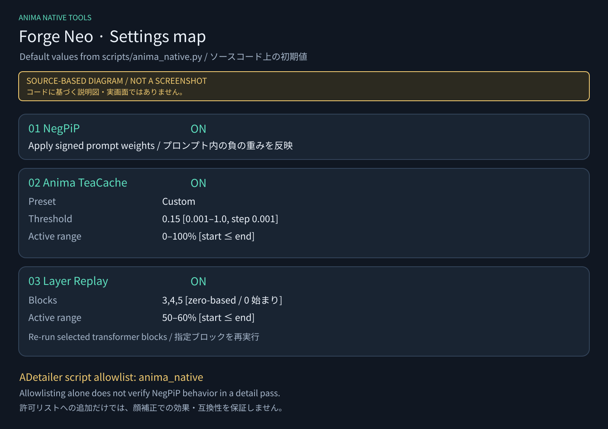
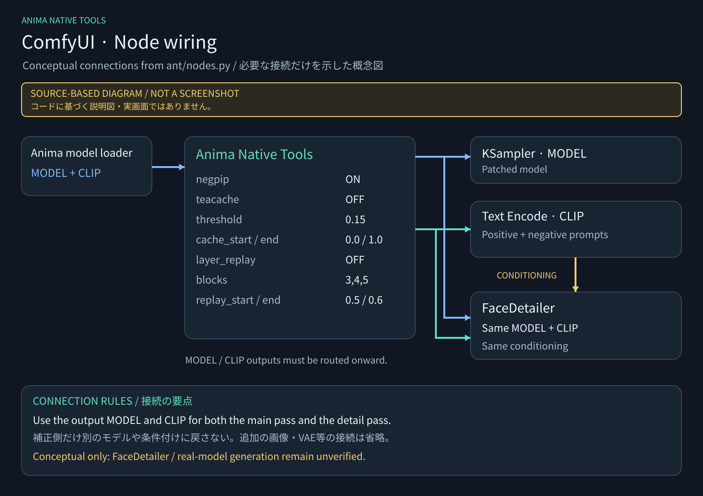

# Anima Native Tools

[日本語](README_JP.md) | English

NegPiP, TeaCache and Layer Replay for Anima, packaged in **one repository for Forge Neo and ComfyUI**. Clone or extract the same folder into the host's extension directory.

## Features

- **NegPiP:** processes negative prompt weights by using their magnitude for conditioning and applying their sign to cross-attention values. This is separate from the negative-prompt text box.
- **TeaCache:** reuses an estimated transformer residual when its change metric stays below the threshold. This is an approximation, not a guaranteed lossless optimization. Speed and image changes depend on the model, sampler and settings.
- **Layer Replay:** runs selected transformer blocks a second time within a specified sampling interval. It changes the computation and may increase execution time. It is not a guarantee of higher image quality.

The Forge adapter and ComfyUI adapter have separate host entry points. A shared repository does **not** mean that the two hosts use identical conditioning or sampling internals.

## Installation

Use a Forge Neo build with native Anima support, or a ComfyUI build with native Anima and its model-wrapper APIs. SDXL, SD 1.x and other model families are not supported by this extension.

### Forge Neo

From the Forge Neo root directory:

```sh
git clone https://github.com/asugonomi/anima-native-tools.git extensions/anima-native-tools
```

Or extract the repository so that this file exists:

```text
extensions/anima-native-tools/scripts/anima_native.py
```

Restart Forge Neo and open the **Anima Native Tools** panel in txt2img or img2img. The Forge adapter ignores non-Anima models.

### ComfyUI

From the ComfyUI root directory:

```sh
git clone https://github.com/asugonomi/anima-native-tools.git custom_nodes/anima-native-tools
```

Or extract the repository so that this file exists:

```text
custom_nodes/anima-native-tools/__init__.py
```

Restart ComfyUI and add **Anima Native Tools (NegPiP / TeaCache / Replay)** from the **Anima Native Tools** category. Its internal node ID is `AnimaNativeTools`. The node rejects non-native-Anima models.

There is no extra installer. It uses the host's existing Python, PyTorch and other dependencies. Do not replace host files or install a second copy alongside an existing `anima-native-tools` extension. Remove an unwanted copy or restore your backup before restarting the host. The opposite host's modules are not imported by each entry point.

To update a Git installation, run `git pull` inside its `anima-native-tools` directory, then restart the host. Back up any local modifications first.

## Forge Neo controls



*Source-based settings diagram, not a screenshot of the application.*

**All three feature switches default to ON in the Forge implementation.** Start by disabling TeaCache and Layer Replay when establishing a baseline.

| Control | Default / range | Meaning |
|---|---|---|
| NegPiP | ON | Enable signed negative-weight conditioning for Anima. |
| Anima TeaCache | ON | Enable residual-cache approximation. |
| TeaCache preset | `Custom` | Fill the threshold, cache start and cache end fields from the table below. It does not select or change the sampler. |
| TeaCache threshold | `0.15`; `0.001–1`, step `0.001` | Accumulated change threshold. Higher values generally permit more reuse, with a potentially larger image difference. |
| TeaCache start (%) | `0`; `0–100` | Beginning of the cache interval. |
| TeaCache end (%) | `100`; `0–100` | End of the cache interval. Start must not exceed end; otherwise TeaCache is skipped with a warning. |
| Layer Replay | ON | Run the selected blocks a second time within the replay interval. |
| Block numbers | `3,4,5` | Comma-separated, zero-based block indices. Each must exist in the loaded model. Invalid values disable Replay with a warning. |
| Layer Replay start (%) | `50`; `0–100` | Beginning of the replay interval. |
| Layer Replay end (%) | `60`; `0–100` | End of the replay interval. Start must not exceed end. |

Changing a preset updates only the three TeaCache numeric fields. Manually editing one of those fields returns the preset selector to `Custom`.

### Forge TeaCache presets

These presets are starting points. Adjust them to the model and sampler you use.

| Preset | Threshold | Start (%) | End (%) |
|---|---:|---:|---:|
| ER SDE / Conservative | 0.15 | 0 | 100 |
| ER SDE / Balanced | 0.20 | 0 | 100 |
| ER SDE / Aggressive | 0.35 | 0 | 100 |
| Euler a / Conservative | 0.75 | 0 | 75 |
| Euler a / Balanced | 0.85 | 0 | 75 |
| Euler a / Aggressive | 0.85 | 0 | 100 |
| Euler / Conservative | 0.05 | 0 | 100 |
| Euler / Balanced | 0.075 | 30 | 100 |
| Euler / Aggressive | 0.075 | 10 | 100 |

## ComfyUI node and parameters



*Source-based node/wiring diagram, not a screenshot of the application. It shows the relevant connections only; normal KSampler inputs, latent, VAE and other workflow components are omitted.*

Basic wiring:

```text
Anima MODEL ──> Anima Native Tools ──> MODEL ──> KSampler / FaceDetailer
Anima CLIP  ──>                    ──> CLIP  ──> prompt encoders
                                                  └──> positive / negative conditioning
                                                       for KSampler / FaceDetailer
```

Use the output MODEL for both the main sampler and any Detailer pass. Encode the prompts with the output CLIP and pass that conditioning to both paths. If a Detailer or a pipe-building node substitutes its own MODEL, CLIP or conditioning, this connection no longer guarantees that the same settings reach the detail pass.

| Input | Default / range | Meaning |
|---|---|---|
| `model` | MODEL connection | Native Anima model to clone and patch. |
| `clip` | CLIP connection | Anima text encoder to clone and pass through the pipeline with the NegPiP flag when enabled. |
| `negpip` | `true` | Enable negative-weight sign handling using native Anima `t5xxl_weights`. |
| `teacache` | `false` | Enable TeaCache. The safer comparison baseline is OFF. |
| `threshold` | `0.15`; `0.001–1`, step `0.001` | Accumulated change threshold. Must be positive, including when TeaCache is OFF. |
| `cache_start` | `0.0`; `0–1` | Start fraction of the cache interval. |
| `cache_end` | `1.0`; `0–1` | End fraction of the cache interval. |
| `layer_replay` | `false` | Enable repeated execution of selected blocks. |
| `blocks` | `3,4,5` | Comma-separated, zero-based indices in the loaded model. Validated when Replay is enabled. |
| `replay_start` | `0.5`; `0–1` | Start fraction of the replay interval. |
| `replay_end` | `0.6`; `0–1` | End fraction of the replay interval. |

Outputs: **MODEL**, **CLIP**, in that order. Both intervals must satisfy `0 <= start <= end <= 1`, even when the corresponding feature is OFF. Duplicate Native Tools nodes on the same model path are rejected. Existing upstream PPM NegPiP is rejected when Native Tools NegPiP is enabled.

**Units differ:** Forge uses `0–100`, while ComfyUI uses `0–1`. Furthermore, Forge measures progress as `step / (steps - 1)`, while the ComfyUI adapter estimates the nearest schedule index and uses `index / total_steps`. Equivalent-looking intervals can therefore select different boundary steps. Matching settings do not guarantee matching images across hosts.

The ComfyUI cache is reset around each outer sampling call, on relevant schedule/shape changes, on conditioning or sign-mask changes and when Replay's active state changes. First and last schedule steps are calculated rather than reused. Missing schedule information disables caching and Replay for that call.

## ADetailer compatibility

For variants exposing these settings:

1. Find **Script names to apply to ADetailer**.
2. Add `anima_native` to the existing comma-separated list. Preserve the other entries.
3. Keep **Apply only selected scripts to ADetailer** enabled if desired.

The filter matches the Python filename without `.py`, not the display title or repository name. This permission step alone does not require modifying ADetailer's source. The package does not automatically edit its settings or source.

The allowlist controls whether ADetailer runs this script. The selected variant must also preserve the script arguments, conditioning and sampling hooks during its detail pass. For comparisons, keep a baseline image and toggle NegPiP, TeaCache and Replay separately.

## Compatibility notes

- Use native Anima conditioning metadata. Custom prompt encoders must preserve `t5xxl_weights` for the ComfyUI NegPiP path.
- Do not stack this node with another TeaCache, Replay or model-forward replacement. Conflicts are not comprehensively detected.
- Avoid applying a separate NegPiP implementation to the same model path. Not every third-party implementation can be detected automatically.
- Forge Neo and ComfyUI use different model APIs and progress calculations; identical numeric settings do not imply identical output.

## License and credits

Combined distribution: **AGPL-3.0-or-later**, with the Apache-2.0 license retained for the TeaCache-derived component. See [LICENSE](LICENSE), [THIRD_PARTY.md](THIRD_PARTY.md) and [licenses/Apache-2.0-TeaCache.txt](licenses/Apache-2.0-TeaCache.txt).

- [ComfyUI-ppm](https://github.com/pamparamm/ComfyUI-ppm): Anima NegPiP implementation.
- [ComfyUI-Anima-TeaCache](https://github.com/CocyNoric/ComfyUI-Anima-TeaCache): TeaCache implementation.

No model weights, LoRA files, training data or personal settings are included.
