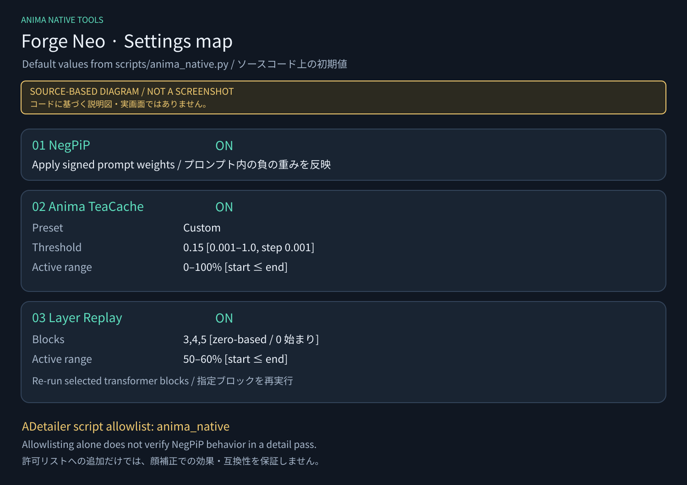
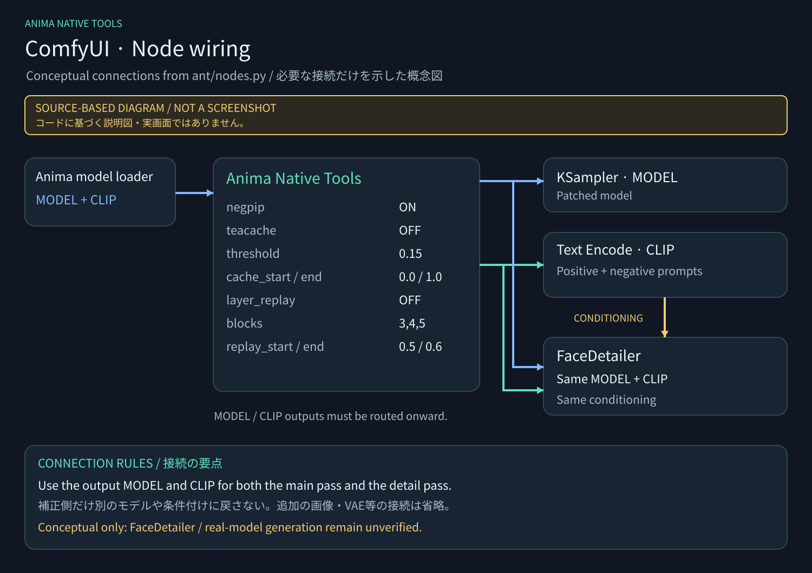

# Anima Native Tools

日本語 | [English](README.md)

Anima 向けの NegPiP・TeaCache・Layer Replay を、**Forge Neo と ComfyUI で共通のリポジトリ**にまとめた拡張です。同じフォルダを、それぞれの拡張ディレクトリへ配置して使います。

## 機能

- **NegPiP：** 負のプロンプト重みの絶対値を条件付けへ使い、符号をクロスアテンションの Value に反映します。通常のネガティブプロンプト欄とは別の仕組みです。
- **TeaCache：** 内部の変化量が閾値を下回る場合に、Transformer の残差を再利用します。近似処理であり、画質を完全に維持する最適化ではありません。速度や画像の変化はモデル・サンプラー・設定によって異なります。
- **Layer Replay：** 指定した区間で特定の Transformer ブロックをもう一度実行します。計算内容が変わり、処理時間が増える場合があります。画質向上を保証する機能ではありません。

Forge 側と ComfyUI 側には、それぞれ専用の入口があります。同じリポジトリでも、条件付けやサンプリングの内部処理まで同一になるわけではありません。

## 導入

Anima をネイティブ対応で扱える Forge Neo、または native Anima とモデルラッパー API を備えた ComfyUI が必要です。SDXL、SD 1.x など、Anima 以外のモデル用ではありません。

### Forge Neo

Forge Neo 本体のフォルダで実行します。

```sh
git clone https://github.com/asugonomi/anima-native-tools.git extensions/anima-native-tools
```

ZIP から導入する場合は、次の位置にファイルが存在するように展開します。

```text
extensions/anima-native-tools/scripts/anima_native.py
```

Forge Neo を再起動し、txt2img / img2img の **Anima Native Tools** パネルを開きます。Forge 側は Anima 以外のモデルでは処理を行いません。

### ComfyUI

ComfyUI 本体のフォルダで実行します。

```sh
git clone https://github.com/asugonomi/anima-native-tools.git custom_nodes/anima-native-tools
```

ZIP から導入する場合は、次の位置にファイルが存在するように展開します。

```text
custom_nodes/anima-native-tools/__init__.py
```

ComfyUI を再起動し、**Anima Native Tools** カテゴリから **Anima Native Tools (NegPiP / TeaCache / Replay)** ノードを追加します。内部ノード ID は `AnimaNativeTools` です。native Anima 以外のモデルを入力するとエラーになります。

追加インストーラーはありません。Python・PyTorch などは導入先の既存環境を利用します。本体ファイルの上書きは不要です。既存の `anima-native-tools` と二重に導入しないでください。不要なコピーを取り除く、またはバックアップへ戻す場合は、その後に本体を再起動してください。それぞれの入口から反対側のアプリ専用モジュールは読み込みません。

Git で導入した場合は `anima-native-tools` フォルダ内で `git pull` を実行し、本体を再起動すると更新できます。ローカルで変更したファイルは先にバックアップしてください。

## Forge Neo のパラメータ



*コードに基づく設定説明図です。実画面のスクリーンショットではありません。*

**Forge 側は3機能とも初期状態が ON です。** 比較用の基準画像を作る際は、まず TeaCache と Layer Replay を OFF にしてください。

| 項目 | 初期値・範囲 | 説明 |
|---|---|---|
| NegPiP | ON | Anima の負のプロンプト重みに符号処理を適用します。 |
| Anima TeaCache | ON | 残差キャッシュによる近似処理を有効にします。 |
| TeaCache プリセット | `Custom` | 下表から閾値・開始・終了の3項目を設定します。サンプラー自体は変更しません。 |
| TeaCache 相対閾値 | `0.15`、`0.001～1`、刻み `0.001` | 蓄積した変化量の閾値です。一般に大きいほど再利用しやすくなりますが、画像の変化も大きくなる可能性があります。 |
| TeaCache 開始 (%) | `0`、`0～100` | キャッシュを使う区間の開始位置です。 |
| TeaCache 終了 (%) | `100`、`0～100` | 区間の終了位置です。開始が終了を超えると警告を表示し、TeaCache をスキップします。 |
| Layer Replay | ON | 指定した区間で対象ブロックをもう一度実行します。 |
| 再実行するブロック番号 | `3,4,5` | 0 始まりの番号をカンマ区切りで指定します。読み込んだモデル内に存在する番号が必要です。不正な指定では警告を表示し、Replay をスキップします。 |
| Layer Replay 開始 (%) | `50`、`0～100` | 再実行する区間の開始位置です。 |
| Layer Replay 終了 (%) | `60`、`0～100` | 区間の終了位置です。開始は終了以下にしてください。 |

プリセットが変更するのは TeaCache の数値3項目だけです。この3項目を手動で編集すると、プリセット表示は `Custom` に戻ります。

### Forge の TeaCache プリセット一覧

各プリセットは調整の出発点です。使用するモデルやサンプラーに合わせて変更してください。

| プリセット | 閾値 | 開始 (%) | 終了 (%) |
|---|---:|---:|---:|
| ER SDE / Conservative | 0.15 | 0 | 100 |
| ER SDE / Balanced | 0.20 | 0 | 100 |
| ER SDE / Aggressive | 0.35 | 0 | 100 |
| Euler a / Conservative | 0.75 | 0 | 75 |
| Euler a / Balanced | 0.85 | 0 | 75 |
| Euler a / Aggressive | 0.85 | 0 | 100 |
| Euler / Conservative | 0.05 | 0 | 100 |
| Euler / Balanced | 0.075 | 30 | 100 |
| Euler / Aggressive | 0.075 | 10 | 100 |

## ComfyUI のノードとパラメータ



*コードに基づくノードと接続の説明図です。実画面のスクリーンショットではありません。関係する接続だけを示した概念図のため、KSampler の通常の入力、latent、VAE などは省略しています。*

基本的な接続は次のとおりです。

```text
Anima MODEL → Anima Native Tools → MODEL → KSampler / FaceDetailer
Anima CLIP  →                    → CLIP  → プロンプトのエンコード
                                             └→ positive / negative 条件付け
                                                 → KSampler / FaceDetailer
```

出力 MODEL を通常のサンプラーと Detailer の両方へ渡してください。出力 CLIP でプロンプトをエンコードし、その条件付けも両方へ渡します。Detailer や pipe 作成ノードで別の MODEL・CLIP・条件付けに置き換えると、同じ設定を引き継ぐ接続ではなくなります。

| 入力 | 初期値・範囲 | 説明 |
|---|---|---|
| `model` | MODEL 接続 | 複製してパッチを適用する native Anima モデルです。 |
| `clip` | CLIP 接続 | 複製して後段へ渡す Anima 用エンコーダーです。NegPiP が ON の場合は対応フラグを設定します。 |
| `negpip` | `true` | native Anima の `t5xxl_weights` を使い、負の重みの符号を処理します。 |
| `teacache` | `false` | TeaCache を有効にします。比較用の基準は OFF です。 |
| `threshold` | `0.15`、`0.001～1`、刻み `0.001` | 蓄積した変化量の閾値です。TeaCache が OFF でも正の値が必要です。 |
| `cache_start` | `0.0`、`0～1` | キャッシュ区間の開始割合です。 |
| `cache_end` | `1.0`、`0～1` | キャッシュ区間の終了割合です。 |
| `layer_replay` | `false` | 指定ブロックの再実行を有効にします。 |
| `blocks` | `3,4,5` | 0 始まりのブロック番号をカンマ区切りで指定します。Replay 有効時に番号を検証します。 |
| `replay_start` | `0.5`、`0～1` | 再実行区間の開始割合です。 |
| `replay_end` | `0.6`、`0～1` | 再実行区間の終了割合です。 |

出力は **MODEL、CLIP** の順です。両方の区間とも、機能が OFF であっても `0 <= 開始 <= 終了 <= 1` を満たす必要があります。同じモデル経路への Native Tools ノードの重ね掛けはエラーになります。また、前段に PPM NegPiP が適用済みのモデルで本ノードの NegPiP を ON にするとエラーになります。

**単位に注意：** Forge は `0～100`、ComfyUI は `0～1` です。さらに進捗の計算方法も異なり、Forge は `step / (steps - 1)`、ComfyUI はシグマのスケジュールから近い index を求めて `index / total_steps` を使います。見かけ上同じ区間でも境界のステップが一致しない場合があります。同じ設定にしても、両アプリで同じ画像になる保証はありません。

ComfyUI 側のキャッシュは、外側のサンプリング呼出しの開始・終了、関係するスケジュールや形状の変化、条件付けや符号マスクの変化、Replay の有効区間への出入りで破棄します。スケジュールの最初と最後のステップは再利用せず計算します。必要なスケジュール情報がない場合、その呼出しではキャッシュと Replay を使用しません。

## ADetailer との組合せ

次の設定項目を備えた派生版では、以下のように設定します。

1. **Script names to apply to ADetailer** を開きます。
2. 既存のカンマ区切りリストへ `anima_native` を追加します。他の項目は残してください。
3. **Apply only selected scripts to ADetailer** は、必要に応じて ON のままで構いません。

照合対象は表示名やリポジトリ名ではなく、Python ファイル名から `.py` を除いた名前です。この許可だけなら ADetailer 本体のソース改変は不要です。本パッケージが ADetailer の設定やソースを自動で変更することはありません。

許可リストは、ADetailer が本スクリプトを実行するかどうかを制御します。顔補正へ設定を引き継ぐには、使用する派生版がスクリプトの引数、条件付け、サンプリングフックを維持する必要があります。比較する際は基準画像を残し、NegPiP・TeaCache・Replay を個別に切り替えてください。

## 組合せに関する注意

- native Anima の条件付けメタデータを使用してください。ComfyUI の NegPiP では、カスタムエンコーダーも `t5xxl_weights` を保持する必要があります。
- 別の TeaCache、Replay、モデルの forward を置き換えるノードと重ねないでください。競合をすべて自動検出できるわけではありません。
- 同じモデル経路で別実装の NegPiP を重ねないでください。すべての外部実装を自動検出できるわけではありません。
- Forge Neo と ComfyUI はモデル API や進捗の計算方法が異なります。同じ数値を指定しても、同じ出力になるとは限りません。

## ライセンス・出典

統合配布物は **AGPL-3.0-or-later** です。TeaCache 由来の部分には Apache-2.0 のライセンスも保持しています。[LICENSE](LICENSE)、[THIRD_PARTY.md](THIRD_PARTY.md)、[licenses/Apache-2.0-TeaCache.txt](licenses/Apache-2.0-TeaCache.txt) を参照してください。

- [ComfyUI-ppm](https://github.com/pamparamm/ComfyUI-ppm)：Anima NegPiP の実装。
- [ComfyUI-Anima-TeaCache](https://github.com/CocyNoric/ComfyUI-Anima-TeaCache)：TeaCache の実装。

モデル本体、LoRA、学習データ、個人用の設定ファイルは含みません。
